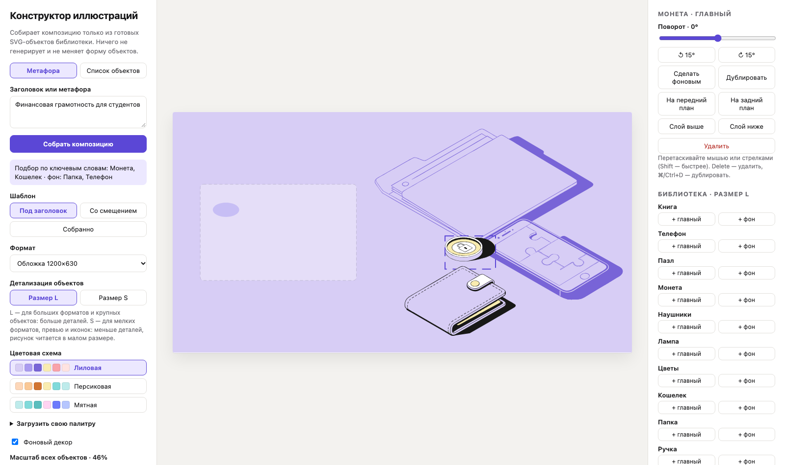
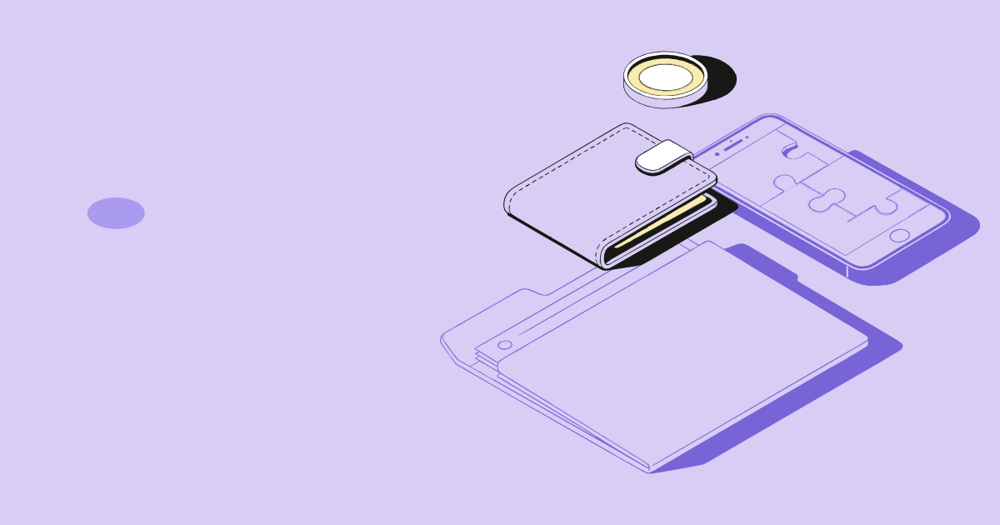
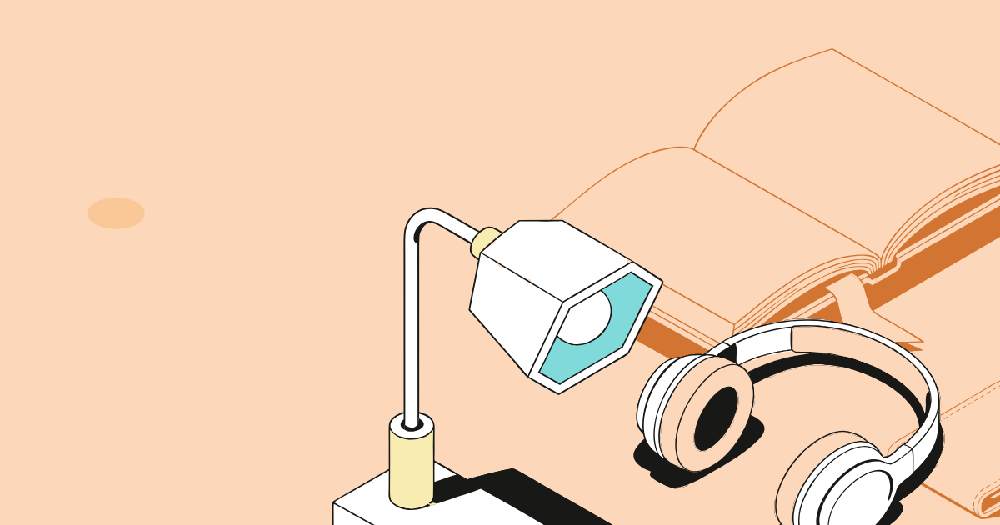

# Конструктор иллюстраций

Веб-сервис, который собирает иллюстрации из готовой библиотеки SVG-объектов. Объекты никогда не генерируются и не меняются: сервис выбирает их, расставляет на холсте и перекрашивает строго по палитре. В результате получается векторный SVG, который можно редактировать.

**Демо:** https://illustration-composer-eight.vercel.app · **Код:** https://github.com/Igor05/illustration-composer



## Что умеет

| Требование | Как сделано |
|---|---|
| Сценарий 1: метафора или заголовок | AI (Claude API) получает заголовок и описание библиотеки и возвращает только `id` подходящих объектов и шаблон. Если API недоступен, работает подбор по смысловым словам (`src/lib/pick.ts`). |
| Сценарий 2: список объектов | Пользователь пишет «книга, лампа, ручка». Сервис распознает формы слов («книгу», «лампы», «ручки») и сообщает, каких объектов нет в библиотеке. |
| Библиотека SVG | 10 объектов × 2 состояния (главный цветной и фоновый монохром) × размеры S и L, итого 40 объектов и фоновый декор для каждого размера. Каждый объект хранится отдельным файлом без изменений (`public/library/<размер>/`). |
| Холст | Перемещение мышью и стрелками, поворот (слайдер и ±15°), дублирование, удаление, порядок слоев, переключение «главный ↔ фоновый», добавление вручную из библиотеки. |
| Размеры и форматы | Детализация S или L, форматы 1200×630, 1080×1080, 1080×1350 и 1920×1080, три шаблона из примеров: «Под заголовок», «Со смещением», «Собранно». |
| Цветовые схемы | Три схемы из макета плюс загрузка своей палитры (JSON или 6 hex-кодов, можно файлом) с автоматической перекраской всей композиции. |
| Экспорт | Один SVG без растра. Каждый объект лежит отдельной именованной группой `<g id="lamp-main-3">` с исходными путями, поэтому файл можно открыть и редактировать в Figma. |

## Правила макета, которые соблюдает сервис

- **Пропорции между объектами не меняются.** У всей композиции один общий масштаб, отдельного масштаба у объекта нет.
- **Объекты не меняются.** Пути и формы копируются из исходника как есть, меняются только значения цветов.
- **Цветовая схема не нарушается.** Перекраска идет слот в слот: 3 цвета фона (от светлого к темному) и 3 акцентных цвета объектов. Обводка `#181817` и белый не трогаются никогда. Фон холста всегда берет цвет фона из схемы.

## Архитектура

```
source/size-S.svg, size-L.svg      экспорт страницы «Библиотека компонентов» из Figma (с id слоев)
        │  scripts/extract-library.mjs   (одноразовая сборка, Playwright)
        ▼
public/library/S|L/<объект>-main|bg.svg   отдельный нетронутый SVG на каждый объект
src/library/extracted.json                размеры и пути файлов
src/library/catalog.ts                    смысл объектов (названия, значения), палитры, форматы, шаблоны
        │
        ▼  в браузере
loadAsset()      загружает SVG и запоминает viewBox и внутреннюю разметку (кэш)
pick.ts          выбор объектов: AI через /api/pick, запасной вариант по ключевым словам
autoLayout()     раскладка кластером + один общий масштаб под область шаблона
recolor()        замена hex по слотам палитры за один проход
buildSvg()       сборка итогового SVG из тех же групп, что на холсте
```

**Хранение.** Каждый объект хранится отдельным файлом, точно в том виде, в каком он был в Figma. Скрипт извлечения находит группы по именам слоев, вырезает их вместе с исходными координатами (`viewBox` равен границам объекта) и удаляет `id` слоев, чтобы при дублировании объектов в одной сцене не возникало конфликтов. Имена слоев в двух экспортах различаются (в L книга, ручка и папка названы, в S это безымянные `Group …`), поэтому соответствие «слой → объект» задается для каждого размера отдельно в `OBJECTS` в начале скрипта.

**Размеры S и L.** Это разные отрисовки, а не масштабированные копии: в L больше деталей (пазл на экране телефона, замок на монете), и объекты примерно вдвое крупнее. Объекты одного размера никогда не смешиваются в одной сцене, поэтому пропорции внутри композиции всегда соответствуют макету этого размера. При переключении размера объекты остаются на своих местах, а общий масштаб подбирается заново.

**Извлечение и переиспользование.** На холсте и в экспорте объект вставляется как группа `<g transform="translate · rotate · scale(общий) · translate(-центр)">` с исходной разметкой внутри. Положение объекта задается координатами его центра, поэтому поворот не сдвигает объект в сторону. Холст и экспорт строятся одной и той же функцией трансформации, так что скачанный файл совпадает с тем, что видно на экране.

**Раскладка.** Самый крупный главный объект ставится в центр. Каждый следующий пробуется на кольцах вокруг кластера и встает в ближайшее место, где перекрытие с соседями небольшое: у главных объектов до 12%, у фоновых до 30%. При выборе места учитывается и пропорция области шаблона. Затем весь кластер одним масштабом вписывается в область шаблона. Фоновые объекты уходят на нижние слои, а из главных выше в стопке тот, что ниже на холсте, как в изометрии. Кнопка «Перемешать» пересобирает композицию с другим зерном случайности.

**AI.** Функция `api/pick.ts` (Vercel Edge) отправляет в Claude заголовок и каталог объектов вида «id: что может означать». Модель возвращает JSON с `id` главных и фоновых объектов, шаблоном и короткой причиной выбора. Ответ проверяется по списку `id`, всё неизвестное отбрасывается. Рисовать модель не может по устройству сервиса: она возвращает только идентификаторы.

## Запуск

```bash
npm install
npm run dev            # http://localhost:5173
```

Подбор через AI на Vercel: задайте `ANTHROPIC_API_KEY` в переменных окружения проекта (необязательно `ANTHROPIC_MODEL`). Без ключа сценарий 1 работает на подборе по ключевым словам.

Деплой: импортировать репозиторий в Vercel, выбрать фреймворк Vite, больше ничего настраивать не нужно.

Пересобрать библиотеку из нового экспорта Figma:

```bash
npx playwright install chromium   # один раз, playwright уже в devDependencies
npm run extract                   # читает source/size-S.svg и source/size-L.svg
```

## Примеры

| | |
|---|---|
| «Финансовая грамотность для студентов» · Под заголовок · лиловая |  |
| «Музыка помогает сосредоточиться на работе» · Со смещением · персиковая |  |
| Список «цветы, книга, ручка» · Собранно · мятная · 1080×1080 |  |
| «Как подписать договор онлайн» · Собранно · персиковая · 1080×1350 · размер L |  |
| Список «наушники, телефон, пазлы» · Под заголовок · лиловая · 1920×1080 · размер L |  |

Примеры 01–03 собраны в размере S, 04–05 в размере L.

Исходные SVG лежат в `examples/`.

## AI-инструменты при разработке

- **Claude Code / Claude:** разбор задания и макета, извлечение библиотеки из экспорта Figma, код приложения, раскладка, проверка экспорта автотестами в браузере (Playwright).
- **Claude API** в самом сервисе: только выбор объектов под метафору.

## Что можно улучшить дальше

- Плагин для Figma на том же ядре (`composition.ts` и `recolor.ts` не зависят от React): собирать композицию прямо в файле с библиотекой.
- Учет «веса» объекта в метафоре (какой объект центральный) и подписи-заголовки прямо в экспорте.
- Сохранение композиций и ссылки на них.
